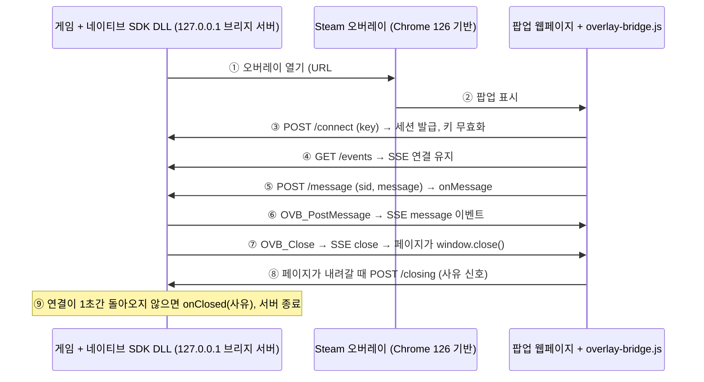

# Steam 오버레이 웹 팝업 브리지 PoC 보고서

Oct 9, 2026 (Oct 11 갱신: Steam Deck 검증, overlay-bridge.js 0.7.4, 네이티브 브리지 DLL, 전수 검사 1~5차 수정)

## 요약

Steam 오버레이 브라우저로 연 웹 팝업도 localhost 브리지를 쓰면 웹↔네이티브 JSON 통신, 게임 코드에서 닫기, 닫힘 감지가 모두 가능합니다. 실제 Steam 오버레이(Windows)와 Steam Deck(Proton)에서 검증했습니다. 단, Steam Deck은 오버레이가 웹 페이지를 한 번에 하나만 보여줘서 자식 팝업은 쓰지 않습니다. 게임 쪽 브리지는 Steamworks를 링크하지 않는 C DLL로 구현했고, 두 환경 모두에서 확인했습니다.

- **목적:** 네이티브 SDK의 웹 팝업 기능을 Steam/Steam Deck에서도 제공. 팝업을 띄우고, 웹과 게임이 메시지를 주고받고, 게임이 닫고, 닫힘을 감지해야 함.
- **문제:** Steam API(`ActivateGameOverlayToWebPage`)는 팝업을 열 수만 있고 닫는 함수가 없음. 닫힘 이벤트도 오버레이 전체 단위라 팝업별로 구분 불가.
- **해결:** 팝업이 떠 있는 동안만 게임이 `127.0.0.1`에 작은 HTTP 서버를 열고, 웹페이지는 CDN 스크립트 `overlay-bridge.js`로 SSE(네이티브→웹)와 POST(웹→네이티브)를 사용. 닫힘은 SSE 연결 끊김으로 판정하며 Steamworks 콜백은 쓰지 않음.
- **웹 페이지 쪽 영향:** `<head>`에 스크립트 한 줄을 넣고, 기존 `window.chrome.webview` 호출을 `OverlayBridge`로 바꾸면 됨. 메시지 형식은 그대로 유지되고, 키·포트 처리는 스크립트가 전담함.

결정 사항:

| 항목 | 결정 |
| --- | --- |
| 통신 방식 | SSE + POST, 키 인증만 (메시지 암호화 없음) |
| SSE 사용 범위 | Steam 오버레이에서만 (UA에 `Valve Steam GameOverlay` 또는 `Valve Steam Gamepad`) |
| 연결 정보 전달 | URL `#` 뒤 파라미터 하나 `ovbk=<토큰>`. 포트와 일회용 키를 합친 47자 base64url |
| 토큰 암호화 | 하지 않음. 복호화 키가 공개 스크립트에 들어가야 해서 보안 이득이 없음 (재검토 후 결정) |
| 배포 | CDN 전역 스크립트 하나 |
| API 모양 | WebView2 `chrome.webview`와 동일 (`postMessage`, `addEventListener`) |
| 메시지 | JSON만, 변환 없이 그대로 전달 |
| 닫힘 감지 | 브리지 연결 상태로만 (Steamworks 콜백 미사용). 사용자 닫기(`USER_CLOSED`)는 최선 노력, 게임은 `CONNECTION_LOST`와 같게 처리 |
| 팝업 안 이동 | 제자리 이동 없음. `_blank` 링크·`window.open()`은 게임을 통해 자식 팝업으로 열고, 부모가 닫히면 자식도 닫음 |
| Steam Deck 자식 팝업 | 막음. 게임이 연결 시 `canOpenPopup: false`를 알려주고, 페이지에서는 아무것도 열리지 않음 |
| 스레드 | 게임은 모든 export 함수를 메인 스레드에서 호출하고 `OVB_Update()`를 매 프레임 호출. 자식 팝업 열기와 콜백은 그 안에서 실행. 라이브러리는 창·훅을 만들지 않음 |
| Steam DLL | 링크하지 않고 게임이 불러온 `steam_api64.dll`에서만 찾아 호출. Steam이 없으면 기능만 꺼짐 |
| 배포 형태 | DLL + 헤더만으로 사용 가능 (`ovb_bridge_loader.h`, `.lib` 선택) |
| 의존성 | `overlay-bridge.js`는 외부 라이브러리 없이 ES5만 사용(Chrome 전용 금지). C 라이브러리는 Windows SDK만 사용 |
| iframe 래퍼, 네이티브 렌더링, 키 입력 흉내, WebSocket | 사용하지 않음 |
| 일반 브라우저(외부 Chrome 등) | 지원 대상 아님, 검증하지 않음 |

## 환경별 팝업 경로

팝업을 여는 경로는 세 가지이며, 웹페이지는 어느 경로든 같은 `OverlayBridge` API를 씁니다. Google Play Games는 별도 경로가 필요 없습니다.

| 경로 | 상태 | 판별 (`getEnvironment()`) | 웹→네이티브 | 네이티브→웹 | 닫기 / 닫힘 감지 |
| --- | --- | --- | --- | --- | --- |
| WebView2 (PC 런처) | 현재 기본 | `window.chrome.webview` 존재 → `webview2` | `chrome.webview.postMessage` 그대로 | WebView2 `message` 이벤트 그대로 | 런처가 창을 직접 관리 |
| CEF (네이티브 SDK DLL 내장) | 적용 예정 | 네이티브 SDK 전용 표시 (미정) | 미정 | 미정 | 네이티브 SDK가 브라우저 수명 이벤트로 직접 관리 |
| Steam / Steam Deck 오버레이 | PoC 검증 완료 (Windows, Steam Deck) | UA에 `Valve Steam GameOverlay`(Windows) 또는 `Valve Steam Gamepad`(Deck) → `steam-overlay` | `fetch` POST (localhost) | SSE (localhost) | SSE `close` → `window.close()` / 연결 끊김 + 1초 유예, 페이지 신호로 사유 구분 |
| 그 외 브라우저 | 미지원 | `none` | 없음 (`false` 반환) | 없음 | — |

- **판별 순서는 Steam → WebView2 → CEF**입니다. Steam 오버레이도 Chromium(CEF) 기반이라, 일반적인 CEF 흔적으로 판별하면 Steam과 겹칩니다. CEF 경로는 네이티브 SDK 전용 표시(예: UA의 `네이티브 SDK/<버전>`)를 권장합니다.
- \*\*Google Play Games(PC)\*\*는 네이티브 Windows 게임을 지원하지만, 오버레이에 URL을 여는 API나 닫기 API가 없습니다. 따라서 WebView2/CEF 경로를 그대로 씁니다. 단, Google Play 결제 정책상 OverlayBridge 스토어·결제 팝업은 정책 위반 위험이 있어 Google 확인이 필요합니다 ([Play Games PC SDK](https://developer.android.com/games/playgames/native-pc/setup), [결제 정책](https://support.google.com/googleplay/android-developer/answer/9858738?hl=en)). Steam Deck/Linux는 지원하지 않습니다.

## Steam 오버레이 검증 결과

아래 결과는 Windows Steam 클라이언트, Spacewar(앱 480) 예제를 수정한 빌드, Modal 모드 기준입니다. Steam Deck 결과는 "Steam Deck 검증" 절에 따로 정리했습니다.

### Steam API만 썼을 때의 한계

| 닫는 방법 | 닫힘 | 오버레이 이벤트 `userInitiated` | 비고 |
| --- | --- | --- | --- |
| 페이지의 `window.close()` | 닫힘 | 0 | 팝업 안에서 페이지를 이동한 뒤에도 닫힘 |
| 브라우저 창 X 버튼 | 닫힘 | 0 | `window.close()`와 구분 불가 |
| Shift+Tab | 숨겨지기만 함 | 1 | 팝업이 남아 있다가 다음에 오버레이를 열 때 다시 나타남 |
| 게임 코드 | **불가** | — | SDK 1.62에 닫기 함수 없음 |

- **여러 팝업:** 동시에 여러 개 띄울 수 있습니다. 하지만 게임이 받는 이벤트는 오버레이 전체 기준 열림 1회, 닫힘 1회뿐이라 팝업별 닫힘을 알 수 없습니다.
- **`spacewar://` 프로토콜 이동:** `window.open()`으로 연 팝업에서는 게임에 콜백이 오지 않았습니다.

### User-Agent

Steam 오버레이 브라우저가 실제로 보낸 값입니다.

```
Mozilla/5.0 (Windows NT 10.0; Win64; x64; Valve Steam GameOverlay/default/1788652215) AppleWebKit/537.36 (KHTML, like Gecko) Chrome/126.0.6478.183 Safari/537.36
```

- Windows 오버레이는 `Valve Steam GameOverlay`를 포함합니다. Steam Deck 오버레이는 이 문자열이 없고 `Valve Steam Gamepad`를 포함합니다(아래 Deck 절). 0.6.1부터 둘 다 Steam 경로로 판별합니다. `Gamepad`는 PC Big Picture에서도 쓰일 수 있으나 미확인이며, 토큰이 없는 페이지는 연결하지 않으므로 위험은 낮습니다.
- 뒤의 숫자와 Chrome 버전은 바뀔 수 있어 비교에 쓰지 않습니다. UA에 앱 ID나 별도 Steam 헤더는 없습니다.

### 브리지 실제 테스트 (overlay-bridge.js 0.2.1)

게임 쪽 서버는 Python 임시 서버로 대신했고, 실제 Steam 오버레이에서 진행했습니다.

| 시각 | 흐름 | 결과 |
| --- | --- | --- |
| 15:26:43 | 닫힘 감지 | 연결이 3초간 돌아오지 않아 닫힘으로 판정, 브리지 서버 종료 |
| 15:26:40 | 네이티브가 닫기 요청 | 255ms 뒤 페이지가 스스로 닫힘. 화면에서도 확인 |
| 15:26:10 | 네이티브→웹 `ping` (한글 포함) | 4ms 뒤 웹이 `pong`으로 같은 내용 반환, 한글 유지 |
| 15:25:36 | 웹→네이티브 `postMessage` 4회 | 4건 모두 순서대로 도착 |
| 15:25:21 | 팝업 열림, 일회용 키 교환, SSE 연결 | 정상 |

헤드리스 Chrome 자동 테스트도 통과했습니다.

- 일반 UA에서는 localhost 접속이 0건이었습니다.
- 가짜 `chrome.webview`로 시험한 WebView2 경로는 메시지와 이벤트를 같은 객체 그대로 전달했습니다.
- 스크립트를 중복으로 포함해도 한 번만 초기화됐습니다.
- URL 해시 8가지 형태에서 페이지 원래 해시가 보존됐습니다.
- 보안 검사 9개 항목이 모두 403으로 차단됐습니다: 잘못된 Host, 허용되지 않은 Origin, Origin 없음, 틀린 키, 키 재사용, 틀린 세션(메시지·SSE), 크기 초과 등.

### ovbk 토큰과 프레임워크 호환성 (overlay-bridge.js 0.4.0)

연결 정보를 `ovbk` 하나로 합친 뒤, 자동 테스트 106개가 모두 통과했습니다. 실제 Steam 오버레이(Windows)에서도 0.4.0으로 재검증했습니다. C 라이브러리가 만든 `#ovbk=` URL로 팝업을 열었고, 결과는 다음과 같습니다. 키 교환, 웹→네이티브 2건, 네이티브→웹 ping과 14ms 뒤 pong(한글 유지)이 모두 정상이었습니다. 네이티브가 닫자 260ms 뒤 팝업이 스스로 닫혔고(화면에서도 확인), 3초 뒤 브리지가 닫힘을 판정해 서버를 종료했습니다. 테스트 페이지 서버에는 `ovbk` 토큰이 전달되지 않았습니다.

| 테스트 | 결과 | 확인 내용 |
| --- | --- | --- |
| 단위 테스트 | 10 / 10 | C 토큰 = 독립 기준(Node `Buffer`) 인코딩, JS 해석 일치, 잘못된 토큰 거부, 페이지 해시 보존, ES5 문법, 구형 브라우저 환경(`Promise`·타입 배열 없음)에서 오류 없음 |
| 프레임워크 호환성 | 96 / 96 | 아래 조합 × Steam UA·일반 UA |

| 프레임워크 | 라우터 / 방식 | 브라우저 엔진 |
| --- | --- | --- |
| 바닐라 JS | 라우터 없음(쿼리 + `#앵커`), 직접 만든 해시 라우터 | Chromium 156, Firefox 157, WebKit 27 |
| React 19.3 | React Router 7.18: BrowserRouter, HashRouter | 같음 |
| Vue 2.7 | Vue Router 3.6: history, hash | 같음 |
| Vue 3.5 | Vue Router 4.6: history, hash | 같음 |

각 케이스에서 확인한 순서는 이렇습니다.

1. C 라이브러리가 토큰을 붙인 URL을 만듭니다.
2. 스크립트가 라우터보다 먼저 토큰을 지웁니다.
3. 라우터가 원래 경로·쿼리·해시를 그대로 봅니다.
4. ping/pong 왕복이 됩니다.
5. 앱 안에서 화면을 이동해도 연결이 유지됩니다.
6. 네이티브가 닫으면 페이지가 닫히고, 브리지가 닫힘을 감지합니다.

일반 UA에서는 localhost 연결 시도가 0건이었습니다.

참고로, 데스크톱 브라우저는 스크립트가 연 창만 `window.close()`로 닫도록 허용합니다. 그래서 테스트는 `window.open()`으로 팝업을 열어 진행했습니다. Steam 오버레이는 이 제한 없이 닫힌다는 것을 실제로 확인했습니다.

### 팝업 ID와 닫힘 사유 (overlay-bridge.js 0.5.0)

이 절의 판정 규칙(사유 5가지, 3초 유예)은 0.5.x 당시 기준입니다. 현재 규칙(6가지, 1초 유예)은 아래 0.6.0 ~ 0.7.0 절과 사용 문서 8절에 있습니다.

팝업마다 게임이 부여한 ID를 페이지가 `OverlayBridge.getPopupId()`로 확인할 수 있고, 닫힐 때 네이티브는 그 ID와 다섯 가지 사유 중 하나를 받습니다(Steam 경로). 닫힘과 ID는 네이티브가 연결 끊김으로 확정하고, 페이지가 `sendBeacon`으로 보내는 `{popupId, reason}`은 사유를 구분하는 보조 정보입니다. 자동 테스트 26개(Chromium·Firefox·WebKit)가 모두 통과했고, 기존 호환성 테스트 96개도 회귀 없이 통과했습니다.

| 사유 | 판정 | 테스트 방법 |
| --- | --- | --- |
| `NATIVE_REQUEST` | 게임이 닫음 | 네이티브 닫기 요청 |
| `PAGE_REQUEST` | 페이지가 명시적으로 닫음. 그 신호 후 5초 안에 끊긴 경우만 | `window.close()`, `OverlayBridge.closePopup('purchase-done')` (사유 문자열도 전달됨) |
| `CONNECTION_LOST` | 명시적 신호 없이 끊기고 3초 안에 다시 붙지 않음 | 팝업이 다른 사이트로 이동 |
| `NEVER_CONNECTED` | 제한 시간 안에 연결하지 않음 | 팝업을 열지 않음 |
| `SHUTDOWN` | 게임이 브리지를 정리함 | 팝업 2개 + 대기 중 1개에서 종료 요청 |

함께 확인한 것은 다음과 같습니다.

- 팝업마다 ID가 다르고, 같은 도메인 안에서 페이지를 이동해도 ID가 유지됩니다.
- 같은 도메인 안에서의 이동은 닫힘으로 보지 않습니다.
- 팝업 2개 중 하나만 닫으면 그 ID만 닫힘으로 보고됩니다.
- 다른 팝업의 ID나 틀린 세션으로 보낸 닫힘 신호는 403으로 거부됩니다.

**실제 Steam 오버레이(Windows) 확인 결과 (0.5.1)**

| 닫는 방법 | 보고된 사유 | 비고 |
| --- | --- | --- |
| 페이지 `window.close()` | `PAGE_REQUEST` (`window.close`) | 2회 모두 정상 |
| `closePopup('purchase-done')` | `PAGE_REQUEST` (`purchase-done`) | 3회 모두 정상 |
| 브라우저 창 X 버튼 | `CONNECTION_LOST` | 내려갈 때 `pagehide` 신호는 도착 (명시적 닫기가 아니므로 의도대로 판정) |
| Shift+Tab | 닫힘 아님 (연결 유지) | 이후 게임에서 닫자 `NATIVE_REQUEST` |

0.5.0에서는 `window.close()` 경로가 2회 연속 `CONNECTION_LOST`로 잘못 판정됐습니다. 진단 기록으로 확인해 보니, 창을 닫기 직전에 보낸 `sendBeacon`을 Steam 오버레이가 페이지를 즉시 정리하면서 버린 것이 원인이었습니다(`window.close` 감싸기는 정상 적용). 0.5.1은 명시적으로 닫을 때 일반 요청으로 신호를 보내고 응답을 받은 뒤(최대 0.3초) 창을 닫습니다. 실측 지연은 0.1~0.3초였습니다. `NEVER_CONNECTED`와 `SHUTDOWN`은 헤드리스 테스트로만 확인했습니다.

### 사용자 닫기, 자식 팝업 (overlay-bridge.js 0.6.0 ~ 0.7.0, Windows 실제 오버레이)

0.6.0부터 팝업은 제자리에서 이동하지 않고, `_blank` 링크·`window.open()`은 게임을 통해 자식 팝업으로 엽니다. 세션은 저장하지 않습니다. 닫힘 사유는 `USER_CLOSED`를 더해 6가지이고, 재연결 유예는 당시 0.5초였습니다(이후 1초, 아래 "전수 검사 1차 수정" 참고). 이 절의 자식 팝업은 당시 테스트용 Spacewar 훅이 열었습니다(작업 스레드가 대역 서버를 조회하고 메인 스레드가 `ActivateGameOverlayToWebPage` 호출). 지금은 브리지 DLL이 `OVB_Update()`에서 엽니다.

| 확인 항목 | 결과 |
| --- | --- |
| 자식 팝업 (`window.open`) | 게임 메인 스레드에서 열림, 0.4초 만에 연결 |
| 부모를 게임이 닫음 | 부모 `NATIVE_REQUEST`, 자식도 `NATIVE_REQUEST`로 닫힘 |
| Shift+Tab 숨김 → 다시 열기 → `window.close()` | 숨겨도 연결 유지(닫힘 아님), 이후 `PAGE_REQUEST` |
| X 버튼 (0.6.4, 3회) | `USER_CLOSED` 2회, `CONNECTION_LOST` 1회 |
| 같은 URL로 두 번 열기 | 두 번째 페이지는 키 재사용으로 거부 |

X 버튼은 오버레이가 페이지를 아주 빨리 정리해서, 신호가 하나도 나가지 못하는 경우가 있습니다(위 1회). 0.6.4는 닫기 신호 리스너를 스크립트 로드 시 캡처 단계로 등록해 다른 요청보다 먼저 보내지만, 이 경우는 페이지 쪽에서 막을 수 없습니다. 그래서 `USER_CLOSED`는 최선 노력이며, 게임은 `CONNECTION_LOST`를 같은 의미로 처리합니다.

### Steam Deck 검증 (2026-10-11)

SteamOS 3.8.28, Steam 클라이언트 1788652215(stable), Spacewar Windows 빌드를 devkit으로 올려 Proton 11에서 실행했습니다. 페이지 서버와 브리지 대역 서버는 Deck 안에서 Linux Python으로 실행했습니다.

```
Mozilla/5.0 (X11; Linux x86_64; Valve Steam Gamepad [Steam Deck Stable]/default/1788652215) AppleWebKit/537.36 (KHTML, like Gecko) Chrome/126.0.6478.183 Safari/537.36
```

| 확인 항목 | 결과 |
| --- | --- |
| 오버레이 → Deck 안 `127.0.0.1` 서버 | 접속됨. 연결, SSE, 양방향 메시지(한글 포함) 정상 |
| `window.close()` | `PAGE_REQUEST` |
| 닫는 방법 | X 버튼 없음. B 버튼, Steam 버튼(메뉴가 뜬 뒤 0.7~3초 후 정리) |
| B / Steam 버튼 | 페이지가 숨겨지지 않고 정리됨. 게임 이벤트는 `active=0, userInitiated=0`(Windows Shift+Tab과 다름) |
| 사용자 닫기 사유 (0.6.3 이후 6회) | 모두 `USER_CLOSED`. `hidden` 신호는 대부분 끊김보다 0.1~1.3초 먼저 도착(1회는 끊긴 3ms 뒤, 0.5초 유예 안이라 정상 판정). `beforeunload`·`pagehide`는 자주 사라짐 |
| 여러 팝업 | 한 번에 하나만 표시. 두 번째는 앞 페이지를 B로 내려야 보이고, 내려간 앞 페이지는 종료 이벤트를 받고도 살아 있다가 다시 나타남. 게임이 앞 페이지를 닫으면 두 번째 창이 로딩 상태로 멈춤 |
| 자식 팝업 차단 (0.7.0) | `canOpenPopup=false`, `window.open`이 아무것도 열지 않음, 게임에 요청 없음 |
| Proton 안 게임 → Linux `127.0.0.1` (WinHTTP) | 접속됨 (당시 자식 팝업 훅의 대역 서버 조회. 이 훅은 이후 DLL로 대체) |

- Deck에서는 자식 팝업을 신뢰성 있게 보여줄 수 없어 막았습니다. 게임은 `IsSteamRunningOnSteamDeck()`로 판단해 연결 응답에 `canOpenPopup: false`를 넣습니다. 게임이 직접 두 번째 팝업을 여는 경우도 같은 문제가 있으므로, Deck에서는 팝업을 한 번에 하나만 엽니다.
- 이 절의 서버는 Deck 안의 Linux Python 대역이었습니다. Proton 안에서 연 서버(실제 네이티브 SDK DLL)에 오버레이가 접속하는 것은 이후 확인했습니다("네이티브 브리지 DLL" 절의 검증 결과).
- devkit 바로가기의 Proton prefix는 `compatdata/480`이 아니라 바로가기 ID(`compatdata/3655393771`)였습니다. prefix 안 AppData는 게임(바로가기)마다 따로 있습니다.

### WebView2 환경 (PC 런처 경로)

실제 WebView2 컨트롤(런타임 154.0.4258.62)을 띄우는 테스트용 호스트로 12단계가 모두 통과했습니다. 호스트는 런처와 같은 API(`WebMessageReceived`, `PostWebMessageAsJson`/`AsString`, `WindowCloseRequested`)를 씁니다.

| 확인 항목 | 결과 |
| --- | --- |
| 환경 판별 | `webview2`, `isAvailable()` true, `getPopupId()` null |
| 웹 → 네이티브 (`OverlayBridge.postMessage`) | 호스트가 보낸 JSON과 완전히 같은 값을 받음 (한글·중첩 포함) |
| 기존 `chrome.webview.postMessage` | 함께 써도 그대로 동작 |
| 네이티브 → 웹 (`PostWebMessageAsJson`) | 페이지의 `OverlayBridge` 리스너가 받아 응답 (한글 유지) |
| 네이티브 → 웹 (`PostWebMessageAsString`) | `e.data`가 문자열 그대로 전달됨 |
| JSON이 아닌 데이터(순환 참조) | 보내지 않고 `false` 반환 |
| `OverlayBridge.closePopup()`, `window.close()` | 둘 다 호스트의 `WindowCloseRequested` 발생 |

실제 PC 런처가 아니라 테스트 호스트로 확인한 결과입니다. 런처가 다른 설정(예: 스크립트 주입, 내비게이션 제한)을 쓰면 추가 확인이 필요합니다.

## 구조: OverlayBridge와 localhost 브리지

게임은 팝업을 열 때만 브리지 서버를 열고, 웹페이지의 `overlay-bridge.js`가 그 서버에 연결합니다. Steam 오버레이는 팝업을 띄우는 역할만 합니다.



닫힘은 ⑦처럼 게임이 닫든, 사용자가 닫든 ⑨의 연결 끊김으로 확정되고, ⑧의 신호로 사유를 구분합니다.

| 엔드포인트 | 방향 | 내용 |
| --- | --- | --- |
| `POST /connect` | 웹 → 네이티브 | `ovbk` 토큰에 든 일회용 키를 세션 ID로 교환. 키는 즉시 무효. 응답 `{sid, popupId, canOpenPopup}` |
| `GET /events?sid=` | 네이티브 → 웹 | SSE 스트림. `message` 이벤트(JSON 그대로), `close` 이벤트 |
| `POST /message` | 웹 → 네이티브 | `{sid, message}`. message는 변환 없이 게임에 전달 |
| `POST /closing` | 웹 → 네이티브 | `{sid, popupId, reason, explicit}` (`text/plain`). 명시적 닫기는 일반 요청, 그 밖에는 `hidden`·`beforeunload`·`pagehide`마다 `sendBeacon`. 세션과 `popupId`가 맞을 때만 수락 |
| `POST /open` | 웹 → 네이티브 | `{sid, url}`. 자식 팝업 요청. `canOpenPopup`이 false이거나 허용되지 않은 도메인이면 거절 |

웹페이지가 쓰는 API는 `postMessage`, `addEventListener('message' | 'close')`, `removeEventListener`, `getEnvironment`, `isAvailable`, `getPopupId`, `closePopup`, `openPopup`, `canOpenPopup`입니다. 자세한 사용법은 `docs/overlay-bridge-usage.md`에 있습니다.

## 보안 설계와 관련 표준

이 구성만을 정의한 단일 표준은 없습니다. 그래서 기존 표준을 조합했고, 실제 위협인 "사용자가 방문한 다른 웹사이트의 로컬 서버 접근"을 인증과 출처 검사로 막습니다.

| 설계 | 내용 | 막는 것 |
| --- | --- | --- |
| 루프백 전용 바인드 | `127.0.0.1`에서만 연결 수신 (`0.0.0.0` 금지) | 같은 네트워크의 다른 PC 접근 |
| 팝업 수명 동안만 서버 | 실행마다 임의 포트, 닫힘 판정 즉시 종료 | 고정 포트 탐지, 포트 충돌 |
| 키는 URL `#` 뒤 `ovbk`에 | 포트와 키를 `ovbk` 하나로 전달. 웹 서버로 전송되지 않고, 읽은 즉시 주소창에서 제거. 토큰은 암호화하지 않음(복호화 키가 공개 스크립트에 들어가야 해 이득 없음) | 웹 서버 접속 로그·Referer로 키 유출 |
| 일회용 키 → 세션 | 첫 연결에서 세션 ID로 교환 후 키 무효화 | 유출된 키의 재사용 |
| `Host` 헤더 검사 | `127.0.0.1:<포트>`가 아니면 403 | DNS 리바인딩 |
| Origin 허용 목록 | 허용된 도메인(`*.example.com` 등)만, 그 외 403 | 다른 사이트의 접근 |
| 엔드포인트 최소화 | `/connect`, `/events`, `/message`, `/closing`, `/open` 5개, 본문 16KB 제한, JSON 객체만. `/open`은 허용 도메인만 | 웹 요청으로 앱 상태를 바꾸는 공격 |

메시지 암호화는 하지 않습니다. 통신이 PC 내부(`127.0.0.1`)에서만 오가서, 이를 엿들을 수 있는 공격자는 이미 그 PC에서 코드를 실행할 수 있는 상태이기 때문입니다.

### 관련 표준

- [RFC 8252](https://www.rfc-editor.org/rfc/rfc8252) (OAuth 네이티브 앱) §7.3, §8.3: 로컬 서버 방식의 공식 선례입니다. `localhost` 대신 `127.0.0.1` 사용, 루프백에서만 연결 수신, 임의 포트, 필요할 때만 서버 열기를 권고합니다.
- [W3C Secure Contexts](https://w3c.github.io/webappsec-secure-contexts/), [Mixed Content](https://w3c.github.io/webappsec-mixed-content/level2.html): `http://127.0.0.1`은 신뢰 가능한 주소로 취급돼 https 페이지에서도 차단되지 않습니다.
- [WHATWG HTML Server-sent events](https://html.spec.whatwg.org/multipage/server-sent-events.html), Fetch/CORS, [RFC 6454](https://www.rfc-editor.org/rfc/rfc6454) (Origin): 이 구성이 따르는 기본 규칙입니다. SSE는 CORS 보호를 받아, 허용되지 않은 출처는 응답을 읽지 못합니다.
- WebSocket([RFC 6455](https://www.rfc-editor.org/rfc/rfc6455))을 쓰지 않은 이유: CORS가 적용되지 않아 서버가 출처를 직접 막아야 하고, 아래의 Chrome 정책 위험도 똑같이 받기 때문입니다.

참고 사례: Zoom 로컬 서버 취약점(2019, 웹 요청으로 회의 강제 참가), Blizzard Update Agent DNS 리바인딩(2018), eBay의 방문자 로컬 포트 스캔(2020). 출처 링크는 조사 단계에서 수집했고, 본 보고서 작성 시 다시 열어 확인하지는 않았습니다.

## 웹→네이티브 공격 검토

외부 웹사이트가 공격하는 경로는 현재 설계로 막혀 있습니다. 실제 위험은 **허용된 팝업 페이지 안에서 실행되는 스크립트**가 악용되는 경우입니다. 그래서 게임은 웹에서 온 메시지를 신뢰하지 않는 입력으로 다뤄야 합니다. 이 검토는 설계와 PoC 테스트 결과에 근거한 분석이며, 침투 테스트는 아닙니다.

### 다른 웹사이트가 공격하는 경우: 차단됨

| 시도 | 결과 | 근거 |
| --- | --- | --- |
| 브리지 서버에 메시지 전송 | 차단 | Origin 허용 목록 검사 (PoC에서 403 확인) |
| DNS 리바인딩으로 출처 위장 | 차단 | Host 헤더 검사 (403 확인) |
| 키 추측 | 사실상 불가 | 256비트 무작위 일회용 키, 팝업이 떠 있는 동안에만 유효 |
| 쓴 키 재사용, 세션 없이 접속 | 차단 | 키 재사용·틀린 세션 403 확인 |

남는 위험은 낮습니다. 응답 시간 차이 등으로 "지금 팝업이 열려 있다" 정도는 추측할 수 있지만, 메시지를 보내거나 읽을 수는 없습니다.

### 허용된 팝업 페이지 안의 스크립트: 핵심 위험

팝업 페이지에서 실행되는 모든 스크립트는 `OverlayBridge.postMessage`와 세션 정보에 접근할 수 있습니다. 브라우저가 이것을 막을 방법은 없습니다. 다음 경우가 여기에 해당합니다.

- 팝업 페이지의 XSS 취약점
- 페이지에 포함된 외부 스크립트(분석 도구, 광고, 외부 CDN 라이브러리)가 해킹된 경우
- Origin 허용 목록을 넓게 잡아, 사용자 콘텐츠가 올라오는 하위 도메인까지 포함된 경우

공격자가 할 수 있는 것은 "정상 팝업이 보낼 수 있는 메시지를 마음대로 보내는 것"입니다. 피해 규모는 **게임이 그 메시지를 어떻게 처리하느냐**로 정해집니다.

| 위험한 처리 방식 | 예시 공격 | 대응 |
| --- | --- | --- |
| 웹 메시지를 결과의 증거로 신뢰 | 결제 성공 메시지를 위조해 아이템 지급 | 결제·보상 결과는 반드시 OverlayBridge 서버에 재확인 (가장 중요) |
| 메시지 값을 그대로 실행 | URL·파일 경로·명령을 받아 열기·실행 (`file://`, `steam://`, 실행 파일) | 처리할 메시지 종류를 허용 목록으로 제한, URL은 허용 도메인만 |
| 같은 메시지 반복 처리 | 같은 메시지를 수천 번 재전송 | 중복 처리 방지(멱등성), 주문 ID 등으로 확인 |

### 게임을 멈추게 하는 공격(DoS)

| 공격 | 대응 |
| --- | --- |
| 메시지를 대량으로 보내 게임 스레드에 부담 | 초당 메시지 수 제한, 콜백 대기열 상한(DLL 적용: 1024개·8MB, 넘으면 503) |
| 연결을 많이 열거나 아주 느리게 보내기 | 동시 연결 수 제한, 요청 수신 시간 제한 |
| 비정상 JSON (아주 깊은 중첩, 거대 숫자, 잘못된 UTF-8) | 크기 제한(16KB, PoC 적용), 중첩 깊이 제한, 퍼징 테스트. 재귀 방식 C++ 파서는 스택 오버플로로 게임을 멈출 수 있음 |

### 키와 세션이 새는 경우

- **`ovbk` 토큰(키 포함):** 일회용이고, 사용자 PC의 로컬 서버에 허용된 출처로만 쓸 수 있습니다. 외부로 새더라도 원격에서는 쓸 수 없습니다. 분석 스크립트가 주소를 수집하지 않도록 `overlay-bridge.js`를 가장 먼저 로드해야 합니다.
- **세션 ID:** 페이지 메모리와 `127.0.0.1` 요청에만 있고(저장하지 않음), 웹 서버 로그나 Referer에는 남지 않습니다. 다만 팝업 페이지 안의 악성 스크립트는 읽을 수 있습니다.

같은 PC의 악성 프로그램이나 게임 프로세스 안의 다른 코드는 범위 밖입니다. 이 수준의 공격자는 이미 게임 자체를 조작할 수 있어서 브리지로 막을 대상이 아닙니다.

### 권장 사항 (우선순위 순)

1. **웹 메시지를 신뢰 근거로 쓰지 않기:** 결제·보상 같은 결과는 서버에서 재확인합니다.
2. **게임이 처리할 메시지 종류를 허용 목록으로 정의**하고, 각 메시지의 형식을 검사합니다.
3. **Origin 허용 목록을 정확한 출처로 좁히기:** 와일드카드를 쓰지 않고, 사용자 콘텐츠 도메인은 제외합니다.
4. **팝업 페이지 위생 관리:** 외부 스크립트를 최소화하고, 외부 스크립트에는 무결성 검사(SRI)를 적용하고, XSS를 점검합니다.
5. **C++ 쪽 방어:** 메시지 속도 제한, 연결 수와 수신 시간 제한, JSON 중첩 깊이 제한, 퍼징 테스트를 합니다.

1~2번은 네이티브 SDK보다 게임 개발사가 메시지를 처리하는 방식의 문제이므로, 네이티브 SDK 연동 가이드에 명시해야 합니다.

## 위험 요소와 제약

가장 큰 위험은 Steam이 내장 브라우저를 Chrome 142 이상으로 올릴 때 생길 수 있는 로컬 접속 제한입니다. 지금은 Chrome 126이라 영향이 없습니다.

| 위험 | 내용 | 대응 |
| --- | --- | --- |
| Chrome 로컬 네트워크 접근(LNA) 정책 | Chrome 142부터 공개 사이트가 `127.0.0.1`에 접속하려면 사용자 허락이 필요합니다 ([Chrome 블로그](https://developer.chrome.com/blog/local-network-access)). Steam 오버레이가 권한 창을 띄우지 않으면 조용히 실패할 수 있습니다(추론). | 페이지 자체 닫기 버튼 유지, Steam 브라우저 버전 감시, Valve에 정책 문의 |
| 팝업 안 페이지 이동 | 페이지를 새로 로드하면(같은 도메인이어도) 연결이 끝나고 게임에는 `USER_CLOSED`로 보입니다. | SPA 라우팅 사용, 새 내용은 자식 팝업으로 (사용 문서에 명시) |
| 사용자 닫기 사유 | Windows X 버튼에서 페이지 신호가 사라지면 `CONNECTION_LOST`로 보입니다(3회 중 1회). | 게임은 `USER_CLOSED`와 `CONNECTION_LOST`를 같게 처리 |
| Steam Deck 팝업 1개 | 오버레이가 웹 페이지를 한 번에 하나만 보여줍니다. | Deck에서는 자식 팝업 차단(`canOpenPopup`), 게임도 팝업을 하나씩만 열기 |
| 스크립트 로드 순서 | 해시 라우터나 분석 스크립트가 먼저 실행되면 키가 붙은 주소를 읽을 수 있습니다. | `<head>` 맨 앞에서 로드 (사용 문서에 명시) |
| 페이지의 CSP | `connect-src`를 제한하는 페이지는 연결이 막힙니다. 현재 OverlayBridge 페이지에는 CSP가 없습니다. | CSP 도입 시 `http://127.0.0.1:*` 허용 |
| Shift+Tab으로 숨긴 팝업 | 팝업이 없어지지 않고 숨겨지기만 하여, 연결도 유지됩니다. 게임 입장에서는 열려 있는 상태입니다. | 필요 시 게임이 닫기 명령을 보냄 |
| Google Play Games 결제 정책 | 디지털 상품은 Google Play 결제를 써야 하며, 웹 팝업으로 다른 결제를 안내하면 위반 위험이 있습니다. | GPG 배포판에서는 스토어·결제 팝업 비활성화 검토, Google 확인 |

## 네이티브 브리지 DLL (구현, 2026-10-11)

게임 쪽 브리지를 C DLL `overlay_bridge.dll`로 구현했습니다. 실제 오버레이에서 PC와 Steam Deck(Proton) 모두 동작을 확인했고, Python 대역용 자동 테스트 158개도 DLL로 그대로 통과합니다. 의존 DLL은 `WS2_32`·`bcrypt`·`KERNEL32`뿐이고(정적 런타임 `/MT`), Steamworks SDK는 링크하지 않습니다.

### API (`native_bridge/ovb_bridge.h`)

```c
int  OVB_Init(const OVB_Config *config);    /* 허용 Origin, 콜백, (선택) openOverlay */
void OVB_Update(void);                      /* 매 프레임, 메인 스레드: 자식 팝업 열기 + 모든 콜백 실행 */
void OVB_Shutdown(void);                    /* 모든 팝업 SHUTDOWN, 페이지가 닫힐 때까지 최대 3초, 남은 콜백 실행 */

int  OVB_OpenUrl(const char *url, uint32_t *outPopupId);
int  OVB_OpenUrlEx(const OVB_OpenOptions *options, uint32_t *outPopupId);
     /* flags: OVB_OPEN_NO_CHILD_POPUPS (이 팝업과 자식은 새 팝업 금지)
        connectTimeoutMs: 0 = 300초 */
int  OVB_PostMessage(uint32_t popupId, const char *json);   /* 연결된 페이지 수 반환 (0 = 아직 미연결, 버려짐) */
int  OVB_Close(uint32_t popupId);                           /* NATIVE_REQUEST, 자식도 닫힘 */
int  OVB_GetPopupInfo(uint32_t popupId, OVB_PopupInfo *info);  /* 진단: 상태, 사유, 키 사용, 마지막 페이지 신호 */

/* 콜백 (모두 OVB_Update 안에서, 메인 스레드) */
typedef void (*OVB_OnMessage)(uint32_t popupId, const char *json, void *user);
typedef void (*OVB_OnClosed)(uint32_t popupId, OVB_CloseReason reason, const char *pageReason, void *user);
typedef void (*OVB_OnOpened)(uint32_t popupId, uint32_t parentPopupId, const char *url, void *user);
typedef int  (*OVB_OpenOverlay)(uint32_t popupId, const char *url, void *user);  /* 선택: Steam 대신 표시 (테스트·타 플랫폼) */
```

닫힘 사유는 `NATIVE_REQUEST`(1), `PAGE_REQUEST`(2), `CONNECTION_LOST`(3), `NEVER_CONNECTED`(4), `SHUTDOWN`(5), `USER_CLOSED`(6)입니다. 오류는 음수입니다. 예를 들어 `OVB_BRIDGE_ERR_OVERLAY`(-4)는 Steam 오버레이를 쓸 수 없다는 뜻이고, `OVB_BRIDGE_ERR_OVERLAY_DISABLED`(-10)는 사용자가 오버레이를 꺼 두었다는 뜻입니다(켜 달라고 안내).

### 스레드와 게임 연동

- 게임은 모든 함수를 **메인 스레드**에서 부르고, `OVB_Update()`를 매 프레임 부릅니다. 순서: `SteamAPI_Init` → `OVB_Init` → 매 프레임 `OVB_Update` → `OVB_Shutdown` → `SteamAPI_Shutdown`.
- 자식 팝업의 `ActivateGameOverlayToWebPage`와 모든 콜백은 `OVB_Update()` 안에서, 즉 메인 스레드에서 실행됩니다. 게임 쪽 동기화가 필요 없습니다.
- 라이브러리는 **창을 만들지 않고 훅도 설치하지 않습니다**(결정 사항). 그래서 메인 스레드로 넘기는 방법으로 `OVB_Update()` 호출 방식을 택했습니다.
- localhost 서버, SSE, 닫힘 판정은 내부 브리지 스레드 하나(Winsock `select`)가 처리합니다. `OVB_Update()`가 늦어도 판정은 정확하고, 콜백만 다음 호출까지 기다립니다.
- 콜백 안에서 `OVB_PostMessage`·`OVB_Close`는 부를 수 있습니다(Deck에서 확인). `OVB_Shutdown`은 금지입니다. `json`·`url` 문자열은 콜백이 끝나면 해제됩니다.

### Steam이 없는 환경

- `steam_api64.dll`은 링크하지 않고, 게임이 이미 불러온 경우에만 `GetModuleHandle`로 찾습니다(`LoadLibrary` 하지 않음). 찾는 함수는 `SteamAPI_SteamFriends_v018`, `SteamAPI_ISteamFriends_ActivateGameOverlayToWebPage`, `SteamAPI_SteamUtils_v010`, `SteamAPI_ISteamUtils_IsSteamRunningOnSteamDeck`입니다(SDK 1.62).
- Steam이 없으면 `OVB_Init`은 성공하고, `OVB_OpenUrl`이 `OVB_BRIDGE_ERR_OVERLAY`(-4)를 돌려줍니다. 게임은 이때 팝업 기능만 끄면 됩니다.
- Steam Deck(`IsSteamRunningOnSteamDeck()`)이면 모든 팝업의 `canOpenPopup`이 false이고 `/open`을 거절합니다.

### DLL과 헤더만으로 사용 (`ovb_bridge_loader.h`)

`.lib` 없이 DLL과 헤더만으로 씁니다. `OVB_LoadApi()`가 실행 중에 DLL을 불러옵니다. DLL은 실행 파일 폴더에서만 찾습니다(`LOAD_LIBRARY_SEARCH_APPLICATION_DIR`). DLL이 없으면 `OVB_LoadApi()`가 0을 돌려주고 게임은 그대로 실행됩니다.

```c
OVB_Api ovb;
if (OVB_LoadApi(&ovb, NULL)) { ovb.OVB_Init(&config); /* ... ovb.OVB_Update(); ... */ ovb.OVB_Shutdown(); OVB_UnloadApi(&ovb); }
```

`.lib`로 연결하는 방식도 그대로 쓸 수 있습니다.

### 검증 결과

| 확인 | 결과 |
| --- | --- |
| 자동 테스트 (DLL, ctypes 테스트 호스트) | 158 / 158 (Python 대역과 같은 테스트) |
| Steam 없는 게임 (`.lib` 연결) | 실행됨. `OVB_Init` 0, `OVB_OpenUrl` -4, `steam_api64.dll` 로드 안 됨 |
| DLL + 헤더만 (로더) | DLL 있으면 위와 같음. DLL이 없어도 게임은 실행되고 기능만 꺼짐 |
| PC 실제 오버레이 (Spacewar) | 연결, 웹→게임, 자식 팝업(`onOpened`), 게임→웹 ping/pong, `OVB_Close`로 부모·자식 모두 `NATIVE_REQUEST`. 콜백 모두 메인 스레드 |
| Steam Deck 실제 오버레이 (Proton 11) | **Proton 안 DLL 서버에 오버레이 접속됨.** 웹→게임, 콜백 안 `OVB_PostMessage` → pong 약 17ms, B 버튼 4회 모두 `USER_CLOSED`. 콜백 모두 메인 스레드 |

- Deck에서는 팝업을 띄운 채 게임 화면으로 돌아갈 수 없습니다(Steam 버튼이 팝업을 닫음). 게임→웹 메시지는 웹의 요청에 응답하는 형태가 자연스럽습니다.

### 배포 구성

| 대상 | 배포물 |
| --- | --- |
| 게임 개발사 (네이티브 SDK) | `overlay_bridge.dll`, `ovb_bridge.h`, `ovb_bridge_loader.h` (`.lib`는 선택). 배포 시 네이티브 SDK DLL에 합쳐도 됨 |
| 웹 (CDN) | `overlay-bridge.js` (TypeScript용 `overlay-bridge.d.ts`) |
| 게임이 원래 넣는 것 | `steam_api64.dll` (Steam 판에만) |
| 배포하지 않음 | `tests/`, Python 대역·DLL 테스트 호스트, Spacewar, `test_page/`, `ovb_token.dll` |

런타임은 `/MT` 정적 연결을 유지합니다. Hybrid CRT(UCRT만 동적, Windows 10 이상은 OS 기본)도 가능하지만, Windows 7·8.1에는 업데이트(KB2999226)가 필요해 기본안으로 두지 않았습니다.

### 배포 전 보강 (미적용)

| 항목 | 지금 | 보강 |
| --- | --- | --- |
| 대기 중 CPU | 팝업이 없어도 10ms마다 깨어남 | 이벤트 대기로 바꿔 팝업이 없으면 잠듦 |
| 페이지가 멈췄을 때 보낼 데이터 | 스트림당 4MB 상한, 넘으면 연결 끊기 (2차 수정에서 적용) | — |
| 메시지 폭주 | 제한 없음 | 초당 메시지 수 제한 |
| 입력 검증 | 기능 테스트만 | HTTP·JSON 퍼징, 장시간 실행 테스트 |

### DLL 형태일 때의 보안 고려사항

| 항목 | 위험 | 대응 |
| --- | --- | --- |
| DLL 바꿔치기(하이재킹) | 게임 폴더나 검색 경로에 가짜 DLL을 두면 대신 로드됨 | Authenticode 서명. 로더는 실행 파일 폴더에서만 찾음(`LOAD_LIBRARY_SEARCH_APPLICATION_DIR`). Steam DLL은 불러오지 않고 이미 로드된 것만 사용 |
| 웹 입력 파싱 | HTTP/JSON 파서의 메모리 오류는 게임 프로세스 안에서 실행되는 취약점이 됨 | 검증된 라이브러리 사용, 요청 크기 제한(16KB), 퍼징 테스트 |
| 키 생성 | 예측 가능한 난수는 키 추측을 허용 | OS 암호 난수(`BCryptGenRandom`), 256비트 |
| 웹 메시지 처리 | 웹에서 온 JSON을 그대로 명령으로 실행하면 위험 | 문자열 그대로 게임에 전달만 하고, 처리할 메시지 종류는 게임이 허용 목록으로 제한 |
| 로더 잠금 | `DllMain`에서 스레드·소켓을 만들면 교착 상태 | 모든 자원은 `OVB_Init`/`OVB_Shutdown`에서만 생성·해제 |
| 로그 | 로그에 키·세션이 남으면 유출 경로가 됨 | 키·세션은 기록하지 않음 |
| 같은 프로세스의 다른 코드 | 모드, 항 툴 등은 메모리에서 키를 읽을 수 있음 | 막을 수 없으며 막을 대상도 아님. 키의 목적은 다른 웹사이트 차단 |
| 방화벽 | 모든 주소에서 연결을 받으면 Windows 방화벽 창이 뜨고 LAN에 노출됨 | `127.0.0.1`에만 바인드하면 방화벽 창이 뜨지 않음 |
| 안티치트 | 게임 프로세스 안의 수신 소켓·스레드를 의심할 수 있음 | 서명된 DLL로 배포, 사용 중인 안티치트로 사전 확인 |

## 전수 검사 1차 수정 (2026-10-11)

전체 검사 결과는 `docs/code-review-2026-10-11.md`에 있습니다. 1차로 아래를 고쳤습니다.

| ID | 수정 | 확인 |
| --- | --- | --- |
| B1 | 브리지 스레드를 Win32 스레드로 바꾸고, 실행 중에는 DLL 참조를 유지(`FreeLibraryAndExitThread`). `OVB_Shutdown` 없이 종료하거나 `FreeLibrary`해도 비정상 종료 없음 | `native_bridge/tests/exit_without_shutdown.c` 두 경우 모두 종료 코드 0 |
| B2 | SSE `retry` 1000ms → 200ms, 유예 0.5초 → 1초 (DLL, Python 대역). 이전에는 브라우저가 1초 뒤 재연결해 유예가 아무것도 흡수하지 못했음 | `tests/frameworks/protocol.test.mjs`: 유예 안 재연결은 유지, 이후 끊김은 `CONNECTION_LOST` |
| B3 | Steam 함수와 Deck 여부를 `OVB_OpenUrlEx`마다 다시 확인 (`SteamAPI_Init` 전에 `OVB_Init`해도 Deck 인식) | 빌드, 기존 테스트 |
| J1 | 링크 가로채기를 `window` 버블 단계로 옮김. 페이지가 직접 처리한 링크(`preventDefault`)는 건드리지 않아 팝업이 두 번 열리지 않음 | 프레임워크 테스트 (엔진 3개) |
| J2 | 토큰 제거에 절대 URL 사용 + 예외 처리. 다른 출처의 `<base href>`가 있어도 로드됨 | `apps/vanilla/basehref.html` 테스트 (엔진 3개) |
| S1, S2 | Device ID: 읽지 못한 파일은 덮어쓰지 않음, 이동 후 다시 읽어 반환 | 빌드 |
| S3 | `OverlayExamples.h` 첫 줄의 Valve 저작권 기호를 원본 바이트로 복원 (패치에서 빠짐) | 패치 재생성 |

`overlay-bridge.js`는 0.7.1이 되었습니다(동작 수정, API 변경 없음).

## 전수 검사 2차 수정 (2026-10-11)

| ID | 수정 |
| --- | --- |
| B4 | 게임이 보낸 JSON의 CR/LF를 공백으로 바꿔 SSE 한 줄로 전송 (CR만 있으면 줄이 깨지던 문제) |
| B5 | 이벤트 스트림당 보내지 못한 데이터 4MB 상한. 넘으면 그 연결을 끊고 일반 닫힘 판정을 따름 |
| B6 | `OVB_Shutdown` 중에는 다른 호출(종료 콜백 안의 호출 포함)이 `OVB_BRIDGE_ERR_STATE` |
| B7 | 화면에 보이기 전에 닫힌 자식 팝업은 `onClosed`도 보내지 않음 (게임이 `onOpened`로 알게 된 팝업만 보고) |
| B8 | 열린 팝업 64개(`OVB_BRIDGE_ERR_LIMIT`), 부모당 자식 8개 상한. 보고하지 않은 팝업은 메모리에서 정리 |
| B9 | 닫히는 중인 팝업의 `/open` 거절, 종료 후 대기 목록 비우기 |
| B10 | `openOverlay` 콜백도 콜백으로 표시 (그 안에서 `OVB_Update`·`OVB_Shutdown` 무시) |
| J3, J4 | 닫기 진행 상태 하나로 관리: 두 번째 닫기는 무시, 닫기가 거부되면 1초 뒤 신호를 다시 보낼 수 있음 |
| J5 | 게임이 닫을 때 상태를 먼저 기록한 뒤 `close` 이벤트 (리스너 안의 `window.close()`가 신호를 보내지 않음). 문서에 동기 작업만 가능하다고 명시 |
| J6 | 게임 쪽 브리지가 사라지면 재연결 10회 실패 뒤 중단, 연결 끊김 상태로 |
| J7 | 연결 정보가 있는 페이지의 `openPopup()`은 http(s)가 아닌 URL을 열지 않음. 연결 정보 없는 Steam 페이지의 `canOpenPopup()`은 `true` (일반 창) |
| J8 | 이름 있는 `window.open` 대상(`payWindow`, `_self`, iframe)은 가로채지 않음 |
| J11, J12 일부 | 연결 응답 검증(`sid` 문자열, `canOpenPopup === true`), 실패한 keepalive 요청의 처리 안 된 Promise 거부 제거, `closePopup` 사유 64자로 자름 |
| P1–P4 | Python 대역: 닫힌 팝업의 포트 해제. DLL 테스트 호스트: `/pending`을 메인 스레드에서, 종료 후 상태를 `onClosed` 값으로 기록, 수신 대기열 64. 하네스: 실패 응답은 오류, 재시도는 처리되지 않은 요청만 |
| D7, D8 | `setup.ps1`: 패치된 `sdk\`가 있으면 건너뜀(재실행 가능), D3DX SHA-512 확인(nuget.org 값과 일치 확인), `npm ci`와 실패 검사, Playwright 브라우저 설치, `-Tests` 전에 빌드 결과물 확인, `#Requires -Version 7`. `docs/setup.md` 보강 |

`overlay-bridge.js`는 0.7.2가 되었습니다. 새 테스트: 닫기 두 번, 이름 있는 `window.open`.

## 전수 검사 3차 수정: 중복 정리 (2026-10-11)

동작은 바꾸지 않고 구조만 정리했습니다(S4만 동작 수정).

| ID | 정리 |
| --- | --- |
| C1 | base64url 구현을 `ovb_token.c`의 `ovb_base64url` 하나로. 브리지 DLL은 `ovb_token.h`를 include (토큰 함수는 DLL export에 넣지 않음) |
| C2 | DLL: 닫기 요청 `RequestClose()`, Origin 검사 `IsAllowedOrigin()`, `close` 이벤트 한 번만 생성, JSON 객체 파싱을 한 번에 |
| C3 | `overlay-bridge.js`: POST 코드를 `post()` 하나로, 브리지가 없는 환경을 `noBridge` 객체로 (WebView2와 공용) |
| C4 | 테스트 호스트 2개의 제어 서버를 `tests/frameworks/bridge_control.py` 하나로 (Python 대역·DLL 호스트는 백엔드만 구현). 잘못된 id는 400, 없는 id는 404, 호스트 오류는 500 |
| C5 | 테스트 헬퍼를 하네스로: `useBrowsers`, `closedReason`, `pageClosed`, `disableExitSenders`, `addBlankLink` |
| C6 | Spacewar: 남은 include 제거, URL 파일 읽기 `ReadFirstLine` 하나로(BOM 처리 통일), UTF-8 변환 함수 통일, 테스트 ping 상수, `_WIN32` 가드 정리 |
| C7 | 빌드 스크립트: Visual Studio 찾기를 `tools/find-vs.ps1` 하나로(C++ 도구 확인, 없으면 이유와 함께 중단), `build.ps1`의 환경 변수는 빌드 후 원래대로 |
| C8 | 쓰지 않는 `/pending.txt`, `target_url`, "페이지 이동 재연결" 주석 등 정리 |
| S4 | OVB 메뉴: 팝업 열기 실패 메시지가 이전 팝업 상태로 덮이지 않게 |

## 전수 검사 4차: 테스트 보강 (2026-10-11)

| ID | 추가한 테스트 | 실행 |
| --- | --- | --- |
| T1 | 브라우저 없이 보안 확인: 잘못된 Host, Origin 없음·다른 Origin(preflight 포함), preflight의 CORS·사설망 헤더, 틀린 키·짧은 키·키 재사용, 잘못된 sid(`/events`, `/message`), 객체가 아닌 JSON, 깨진 JSON, 없는 경로, 16KB 초과 본문 | `frameworks/protocol.test.mjs` (Python 대역, DLL 각각) |
| T2 | `/open` 허용 사이트 검사: 비슷한 호스트, `@` 사용자 정보, 다른 scheme·포트, `javascript:`, `data:` 거절, 허용 사이트 수락 | 같음 |
| T3 | 재연결 유예 (1차 수정에서 추가) | 같음 |
| T4 | JSON 그대로 전달 (양방향): 한글·이모지, 중첩, 숫자, 최상위 문자열·숫자·null, CR/LF가 섞인 게임 쪽 JSON | 같음 |
| T5, T6 | DLL C API 직접: 초기화 전후·중복 초기화, 잘못된 인자·`structSize`, 없는 id·닫힌 팝업, JSON 검사(깊이 64/66, 끝 쉼표, 홀로 쓴 서로게이트, 문자열 안 제어 문자, 1MB 초과), 오버레이 실패, 팝업 64개 상한, 종료 콜백 안 호출 거절, 재초기화와 id 증가 | `tests/dll/api_check.py` (42개 항목) |
| T7 | 손자 팝업까지 함께 닫힘, 종료 후 재초기화(T5), 오버레이 실패(T5) | `protocol.test.mjs`, `api_check.py` |
| T8 | Steam 없는 게임(`.lib` 연결, 로더, DLL 없음), `OVB_Shutdown` 없이 종료·언로드 | `tests/unit/native.test.mjs` (빌드 스크립트가 테스트 프로그램도 빌드) |
| T9 | 시간 대기 대신 조건 대기: 앱 내 이동 후 라우터 상태 변화, 거절된 `/open` 요청 종료 | `compat.test.mjs`, `reasons.test.mjs` |

새 테스트가 찾은 문제도 고쳤습니다. Python 대역은 연결만 하고 스트림을 열기 전인 팝업을 닫지 못했고(DLL과 동작을 맞춤), 두 테스트 호스트는 이모지가 든 로그를 Windows 콘솔 인코딩으로 출력하다 요청 처리가 끊겼습니다(로그를 UTF-8로).

### 수정 후 확인 (2026-10-11)

- PC 실제 오버레이(1~4차 수정 후 빌드): DLL 로드, 팝업 열기, 0번 버튼(WEB → NATIVE)과 콜백 안 자동 ping, 게임 메뉴 ping, 자식 팝업, 자식 X 닫기 `USER_CLOSED`, `closePopup` `PAGE_REQUEST`, 게임에서 닫기 `NATIVE_REQUEST`, 종료 시 `OVB_Shutdown` 모두 확인. 콜백은 모두 게임 메인 스레드에서 호출. Steam Deck은 다시 확인하지 않았습니다(이전 검증으로 갈음).
- Spacewar 패치: 원본 SDK 1.62 zip을 새로 풀어 비교. 바뀐 파일은 5개뿐이고, 줄바꿈(CRLF)·BOM 유무·첫 줄(저작권 문자)이 원본과 같으며, 새 폴더에서 `setup.ps1`로 만든 파일이 작업 파일과 바이트 단위로 같습니다.
- 1차 직후 한 번 실패한 Firefox 사용자 닫기 테스트: 같은 테스트를 Python 대역과 DLL로 각각 30회 반복했고 모두 통과했습니다. 당시 실패 메시지가 남지 않아 원인은 확인하지 못했습니다.
- 테스트 페이지: OVB 메뉴로 연 팝업(`?popup=` 없음)에서 자식을 열면 주소가 `?popup=NaN`이 되던 표시 문제를 고쳤습니다(이제 `#10`).

## 전수 검사 5차: 남은 낮은 항목 (2026-10-11)

| ID | 수정 |
| --- | --- |
| B11 | `OVB_Update`를 기다리는 웹 메시지가 1024개 또는 8MB면 더 받지 않음(503, 페이지의 `postMessage()`는 `false`). 게임이 일시 정지·로딩 중이어도 메모리가 계속 늘지 않음 |
| B12 | `SteamFriends` 접근 함수를 v018 다음 v017로도 찾음(SDK 1.62는 v018). 매번 다시 찾기는 1차에서 적용. **오버레이가 꺼져 있으면(`IsOverlayEnabled` false) `OVB_OpenUrl`이 새 오류 `OVB_BRIDGE_ERR_OVERLAY_DISABLED`(-10)를 반환**(게임은 "Steam 오버레이를 켜 주세요" 안내). PC 실기에서 오버레이를 끈 채 열면 이전에는 성공(0)이 반환되고 아무것도 뜨지 않아 5분 뒤에야 `NEVER_CONNECTED`가 되는 것을 확인했음. 자식 팝업도 이때는 열리지 않음(보고 안 함). Steam 초기화 전(`SteamUtils` 없음)에는 켜진 것으로 간주. 게임 시작 직후 몇 초는 오버레이가 로딩 중이라 false일 수 있음(Steam 문서). **추가로 확인한 Steam 동작:** 오버레이가 꺼진 채 `ActivateGameOverlayToWebPage`를 부르면, Steam이 그 요청을 기억했다가 오버레이를 켠 **다음 게임 실행 시작 직후(약 2초)** 그 페이지를 띄움(중간에 오버레이가 꺼진 실행이 한 번 더 있어도 유지). 이 페이지의 토큰은 이전 실행의 것이라 연결되지 않음. 수정 후에는 꺼져 있을 때 호출 자체를 하지 않으므로 생기지 않음(수정 후 끈 상태 실행 → 켠 상태 실행 2회에서 재현 안 됨) |
| B13 | `OVB_Init`이 허용 Origin을 브라우저 형식으로 맞춤(대소문자, 끝 `/`, 기본 포트 443·80). 경로·다른 scheme·공백·사용자 정보·잘못된 포트·비ASCII 호스트(punycode로 줘야 함)·NULL은 `OVB_BRIDGE_ERR_ARGS`. 자식 팝업 `/open`의 주소도 같은 규칙으로 비교(`\`는 `/`로 취급) |
| B14 | 페이지가 로딩 중(연결 전)인 팝업을 닫으면: `onClosed`는 지금처럼 바로 오고, 서버는 최대 60초 더 남아 있다가 페이지가 연결되면 바로 닫으라고 알림(페이지가 화면에 남지 않음). 이 사이 메시지·자식 팝업 요청은 거절. 동시에 16개까지, 종료(`OVB_Shutdown`) 중에는 적용 안 함 |
| B15 | 페이지가 다시 연결되면 닫기 알림의 사유 문자열·시각·명시 여부도 함께 지움 |
| J9 | 새 창 처리 추가: 가운데 클릭, `<base target="_blank">`, SVG 링크(`xlink:href`), `target="_blank"` GET 폼(`formtarget`·`formaction`·`formmethod` 포함). `download` 링크와 POST 폼은 가로채지 않음(게임은 주소만 열 수 있음) |
| J12 | `OverlayBridge.addEventListener('connected', fn)` 추가(연결·재연결 때, 이미 연결된 뒤 등록하면 한 번 바로 호출). 나머지(처리 안 된 Promise 거부)는 2차에서 수정 |

`overlay-bridge.js`는 0.7.3이 되었습니다. Python 대역도 같은 규칙(B13 주소 비교, B14 로딩 중 닫기, B15)으로 맞췄습니다. B11은 DLL에만 있습니다(대역은 메시지를 바로 기록).

새 테스트: `links.test.mjs`(브라우저 3종 × 6개: 가운데 클릭, base target, SVG, GET 폼, download·POST 폼 제외, `connected`), `protocol.test.mjs`(로딩 중 닫힌 팝업, `/open` 대소문자), `api_check.py`(Init 검증 10가지, 메시지 대기열 1024개·8MB, 재연결 시 알림 지움), `steam_path_check.c`(가짜 `steam_api64.dll`로 Steam 경로: 오버레이 꺼짐 -10, 켜짐 Modal로 열기, Deck 자식 팝업 끔, Steam 준비 전). Spacewar OVB 메뉴는 -10이면 "Steam overlay is off" 안내를 보여 줌. 새 링크 테스트 5개는 해당 처리를 빼면 실패하는 것도 확인했습니다.

4차의 `/open` 거절 테스트에서 "다른 포트"와 "비슷한 호스트" 주소를 잘못 만들고 있던 것(`URL.host`에 포트가 이미 들어 있음)도 고쳤습니다. 고친 뒤에도 모두 거절됩니다.

### 연결되지 않는 옛 페이지 자동 닫기 (overlay-bridge.js 0.7.4)

B12 확인 중 찾은 Steam 동작(오버레이가 꺼진 채 요청한 페이지를 다음 실행 때 띄움) 때문에 추가했습니다. 게임 쪽에서는 닫을 수 없습니다(SDK에 오버레이를 닫는 API가 없고, 옛 페이지는 이전 실행의 연결 정보만 가짐).

- 게임이 연 페이지(주소에 연결 정보)가 처음부터 연결하지 못하면 스스로 닫음: 서버 없음(연결 거부)이나 키 거절(403. CORS 헤더가 없어 페이지에는 네트워크 오류로 보임) 모두 0.3초 간격 3번 시도 뒤 닫음. 게임은 서버를 연 뒤 페이지를 띄우므로 정상 팝업은 해당하지 않음.
- `<script ... data-auto-close="false">`로 끌 수 있음(사용자 결정: 스크립트 태그 속성). 개발 중 허용 도메인 문제를 볼 때 등.
- 연결된 뒤 게임이 사라진 경우는 닫지 않음(사용자 결정).
- 주의: 허용 도메인 설정이 틀렸거나 브라우저가 로컬 접속을 막으면(Chrome 142 이후 Local Network Access) 팝업이 잠깐 보였다가 닫힘. 원인을 볼 때는 위 속성으로 끔.
- 테스트: 서버 없는 토큰, 틀린 키, 속성으로 끈 경우(브라우저 3종 × Python 대역·DLL). Windows의 Firefox·WebKit은 닫힌 포트의 거절을 받는 데 약 2초씩 걸려(Chromium은 수 ms) 테스트 대기 시간을 10초로 둠.

## 미검증 항목과 다음 단계

게임 쪽 브리지는 C DLL로 구현해 실제 오버레이(PC, Steam Deck)에서 확인했습니다. 다음은 배포 전 보강입니다.

- [x] 연결 정보 `ovbk` 단일 토큰, C 라이브러리(토큰·URL)
- [x] 실제 Steam 오버레이(Windows): 0.4.0 재검증, 닫는 방법별 사유(0.5.1, 0.6.4), 자식 팝업과 부모 닫기(0.7.0 테스트 훅, 이후 DLL로 재확인)
- [x] Steam Deck: 오버레이 동작, UA, localhost 연결, 닫는 방법별 사유, 여러 팝업 동작, 자식 팝업 차단(0.7.0)
- [x] 네이티브 브리지 DLL 구현: localhost 서버(Winsock), 브리지 스레드, `OVB_Update`, `OVB_*` 함수, 자동 테스트 158개, Steam 없는 환경, 로더 헤더
- [x] DLL로 PC·Steam Deck(Proton) 실제 오버레이 확인 (Proton 안 DLL 서버 접속 포함)
- [ ] 배포 전 보강: 대기 중 깨어남 제거, 전송 큐 상한, 메시지 속도 제한, 퍼징·장시간 테스트
- [ ] 네이티브 SDK DLL에 합칠지, 별도 DLL로 둘지 결정
- [ ] 공개 HTTPS 페이지(실제 OverlayBridge 도메인)에서 localhost 연결 확인
- [ ] PC Big Picture 모드의 UA와 팝업 동작 확인
- [ ] 실제 PC 런처(WebView2)에서 메시지 그대로 전달 확인 (현재는 테스트 호스트로만 확인)
- [ ] CEF 경로 추가: 네이티브 SDK 전용 판별 표시와 웹↔네이티브 방식 결정
- [ ] 팝업에서 열 수 있는 도메인 범위 정리 (Origin 허용 목록의 근거)
- [ ] 게임 개발사용 가이드: 웹 메시지를 신뢰 근거로 쓰지 않기, 처리할 메시지 허용 목록, `USER_CLOSED`/`CONNECTION_LOST` 같은 처리, Deck 팝업 1개
- [ ] Valve에 오버레이 브라우저의 로컬 네트워크 접근 정책과 Deck 여러 팝업 동작 문의, Steam 브라우저 버전 감시
- [ ] Google에 Play Games PC의 웹 팝업·결제 정책, 자식 프로세스(WebView2/CEF) 허용 여부 문의
- [ ] 사용 중인 안티치트와 네이티브 SDK DLL의 localhost 서버 호환성 확인

확인하지 않기로 한 항목: 일반 브라우저(외부 Chrome 등)에서 팝업을 여는 경로.

자동 테스트 현황(0.7.4, 5차 이후): 단위 16개(토큰, ES5, 구형 브라우저, DLL C API, Steam 없는 게임, 가짜 Steam으로 Steam 경로), 프레임워크·닫힘 사유·새 창·프로토콜 208개(Chromium·Firefox·WebKit, Steam Deck UA 포함, Python 대역과 DLL 각각), WebView2 테스트 호스트 12단계 모두 통과. 1차 이후 Python 대역에서 한 번 실패했던 Firefox 사용자 닫기 테스트는 이후 실행(2~4차 전체 실행, 구현별 30회 반복)에서 다시 실패하지 않았습니다(원인 미확인).

## 별도 요청: 기기 공통 Device ID (Spacewar 예제)

게임과 상관없이 기기(OS 사용자)마다 UUID 하나를 저장해 두고, 있으면 반환하고 없으면 만듭니다. 게임을 지워도 남아야 합니다.

| 환경 | 저장 위치 | 확인 |
| --- | --- | --- |
| Windows | `%LOCALAPPDATA%\OverlayBridge\device_id.txt` | 생성·재사용 |
| Steam Deck (Proton) | `~/.local/share/OverlayBridge/device_id.txt` (`XDG_DATA_HOME` 우선) | 생성·재사용 |

- Proton에서는 게임마다 prefix가 따로 있어 prefix 안 AppData는 공유되지 않고 게임과 함께 지워질 수 있습니다. 그래서 Wine 환경(`wine_get_version` 또는 `WINEPREFIX`)이면 Linux 홈에 저장합니다.
- Wine은 Windows 프로그램에 `HOME`을 넘겨주지 않았습니다(Proton 11). 홈은 Wine이 넣어주는 `WINEHOMEDIR`에서 찾았고, Windows 경로는 `wine_get_dos_file_name`으로 만듭니다(드라이브 문자 고정 없음, 실패하면 `\\?\unix\...`). 단, `WINEHOMEDIR` 값은 지금 `Z:` 형식만 인식합니다.
- 파일에는 소문자 UUID만 저장합니다. 임시 파일에 쓴 뒤 이동으로 넣고, 이동 후 디스크의 값을 다시 읽어 반환하므로 두 게임이 동시에 만들거나 고쳐도 같은 ID를 씁니다.
- 파일을 읽을 수 없을 때(다른 프로그램이 잠시 잡고 있음, 권한 없음)는 잠깐 재시도하고, 그래도 안 되면 실패로 보고합니다. 읽지 못했다는 이유로 기존 ID를 덮어쓰지 않습니다. UUID 형식이 아닌 파일만 새 ID로 바꿉니다.
- 게임 삭제 후 유지는 저장 위치로 판단했고, 실제 삭제 테스트는 하지 않았습니다. 드라이브 매핑이 없는 prefix의 `\\?\unix` 경로도 미검증입니다.

## 부록: 산출물

경로는 모두 저장소 루트 기준입니다.

| 파일 | 내용 |
| --- | --- |
| `test_page/overlay-bridge.js` | CDN 배포용 스크립트 0.7.2 (Steam 오버레이·Deck, WebView2 경로, `ovbk` 해석, 팝업 ID, 닫힘 사유 신호, 자식 팝업, `canOpenPopup`) |
| `test_page/overlay-bridge.d.ts` | TypeScript 타입 선언 |
| `docs/overlay-bridge-usage.md` | 웹 개발자용 사용 문서 (일반 HTML, React, Vue 2·2.7·3, Next.js, Nuxt 2·3, SSR 주의, 네이티브 SDK URL·사유 규칙) |
| `docs/overlay-popup-bridge-report.md` | 이 보고서 |
| `docs/setup.md`, `setup.ps1`, `README.md` | 개발 환경 구성(SDK 압축 해제, 패치, D3DX 받기), 빌드, 테스트 안내 |
| `patches/spacewar.patch` | Spacewar 예제 수정분 (원본 SDK 1.62에 적용). SDK 원본은 저장소에 넣지 않음 |
| `native_bridge/ovb_bridge.h`, `ovb_bridge.cpp`, `ovb_bridge_loader.h` | 네이티브 브리지 DLL (`out/overlay_bridge.dll`)과 DLL+헤더용 로더 |
| `native_bridge/ovb_token.c`, `.h`, `build.ps1` | 키 난수, `ovbk` 토큰, 팝업 URL 조립 (DLL 안에 포함, Windows SDK만, 정적 런타임) |
| `native_bridge/tests/nosteam_game*.c`, `steam_path_check.c`, `fake_steam_api.c` | Steam 없는 게임 확인용 (`.lib` 연결, 로더), 가짜 `steam_api64.dll`로 Steam 경로 확인 |
| `tests/frameworks/bridge_dll_host.py`, `bridge_control.py` | DLL용 테스트 호스트 (`npm run test:frameworks:dll`), 두 호스트가 함께 쓰는 제어 API |
| `tools/find-vs.ps1` | 빌드 스크립트가 함께 쓰는 Visual Studio 찾기 |
| `tests/unit/`, `tests/dll/api_check.py` | 단위 테스트, DLL C API 직접 확인 (`npm run test:unit`) |
| `tests/frameworks/` | 프레임워크 호환성·닫힘 사유·새 창 처리(`links.test.mjs`)·브라우저 없는 프로토콜 테스트와 테스트 앱, 네이티브 대역 Python 서버(DLL과 같은 규칙의 테스트용 구현) (`npm run test:frameworks`) |
| `tests/webview2/` | WebView2 테스트 호스트(C#)와 테스트 (`npm run test:webview2`) |
| `test_page/popup_test.html` | 오버레이 수동 테스트 페이지 |
| `sdk/steamworksexample/` (저장소에 없음, `setup.ps1`로 구성) | 테스트용으로 수정한 Spacewar 예제 (오버레이 테스트 메뉴, Windows 메시지 루프 수정, OVB 브리지 메뉴(로더 방식), Device ID) |
| `build.ps1` | Spacewar 빌드 스크립트 (결과물 `bin/`) |

테스트 도구(`acorn`, `playwright`, Vite, React, Vue)는 `tests/` 안에만 있으며 배포물에는 들어가지 않습니다.
